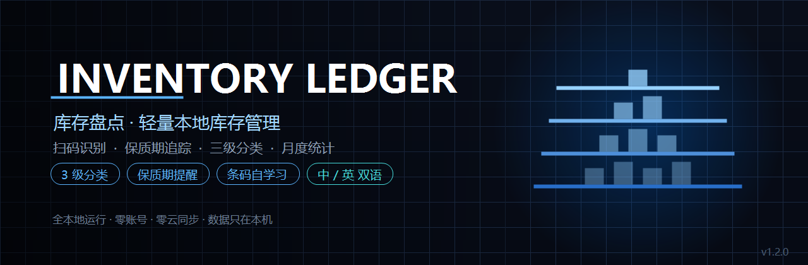
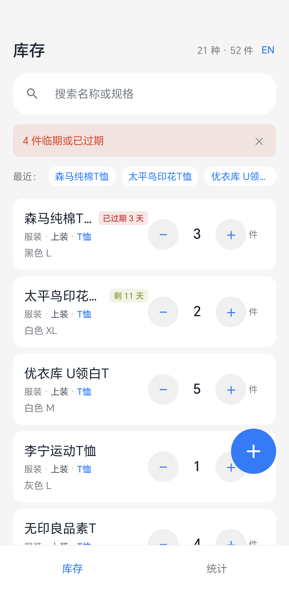
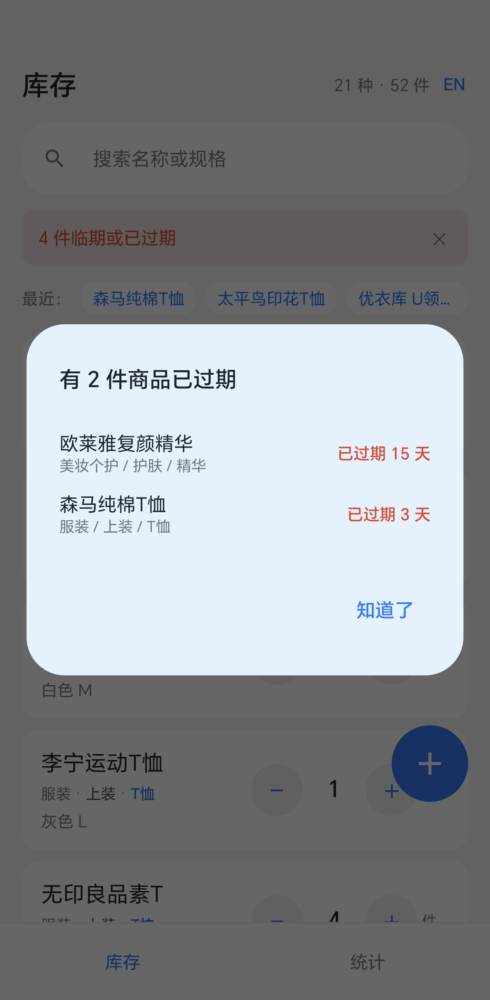
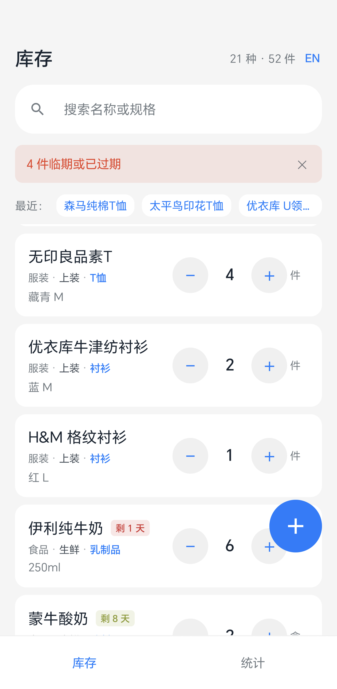
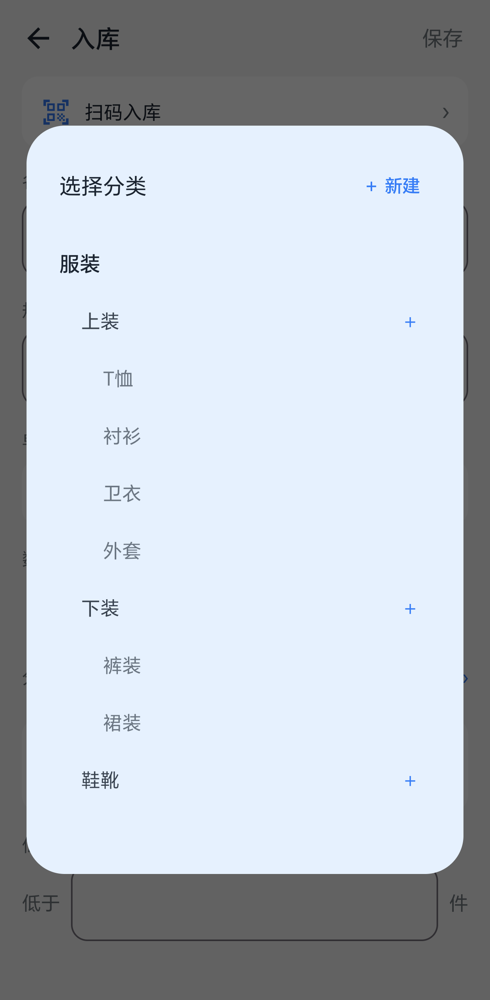
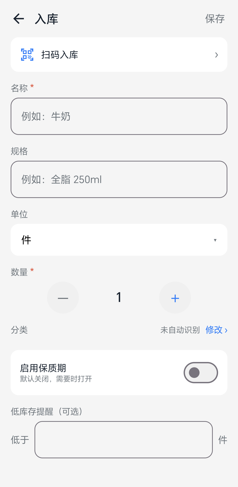
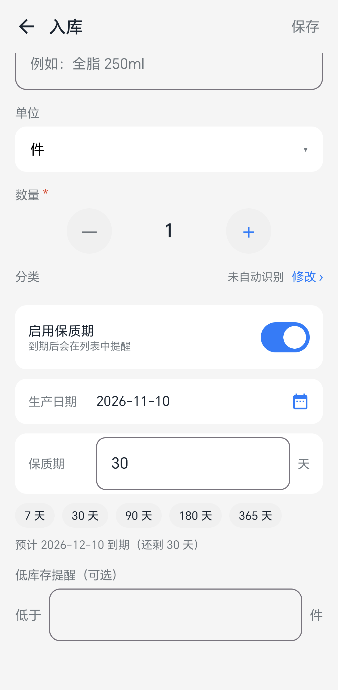
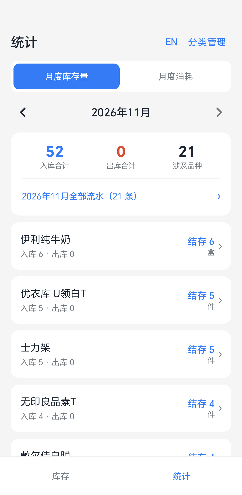
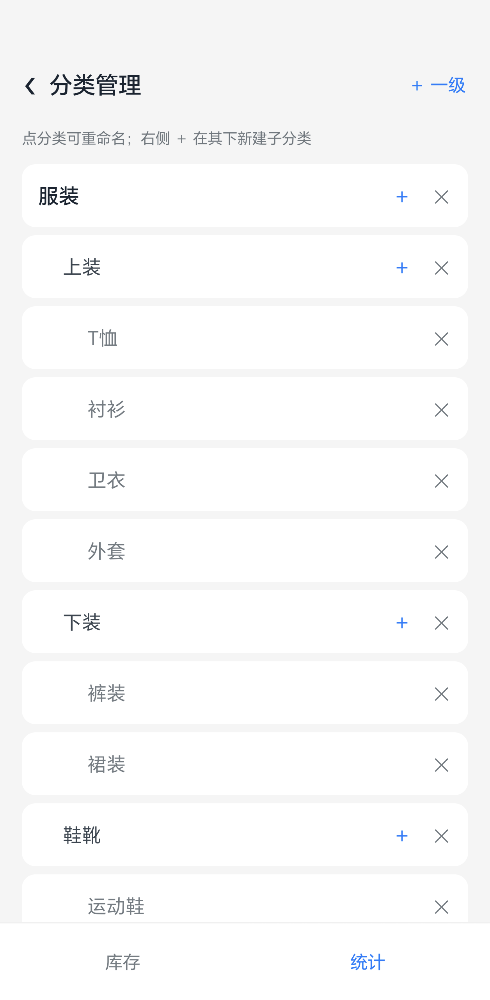

# 库存盘点 · Inventory Ledger

**轻量本地库存管理 · 扫码识别 · 保质期追踪 · 三级分类 ｜ Lightweight offline inventory for Android**

[](https://opensource.org/licenses/MIT)
[](https://kotlinlang.org/)
[](https://developer.android.com/jetpack/compose)
[](https://developer.android.com/training/data-storage/room)
[](https://developer.android.com/about/versions/nougat)
[](https://github.com/Levanll/InventoryLedger/releases/latest)
[](#)

**中文** ｜ [English](README_EN.md) ｜ **[官方网站](https://levanll.github.io/InventoryLedger/)** ｜ [Releases](https://github.com/Levanll/InventoryLedger/releases)



---

## 10 秒看懂

一款 Android 上的个人库存管理工具：扫码或手输入库，直接在主列表加减数量，**保质期商品自动按临期程度排序并显示剩余天数**，进应用先提醒已过期清单。

和其它库存 App 的区别只有三点：**它认三级分类**（美妆个护 → 护肤 → 精华，同分类的商品永远挨在一起，不被保质期打断）、**它完全离线**（Room 本地库，无账号无云同步，联网只用于查条码商品信息且可失败）、**它的数据可解释**（流水只增不删，撤销写补偿记录，月度出入库可追溯到每一条）。

---

## 核心卖点

| | 卖点 | 具体是什么 | 为什么重要 |
|---|---|---|---|
| 🗂 | **三级分类，树形排序** | 一级 → 二级 → 三级（服装 → 上装 → T恤）。分类可自建、改名、删除，系统预置与自建能力完全平等 | 库存一多，二级分类不够用；而三级分类若无正确排序，同级商品会被打散在列表各处 |
| ⏳ | **保质期与临期排序** | 默认关闭，需要时开启；填生产日期 + 保质期天数，自动算到期日。列表内**同分类的商品聚在一起**，组内保质期商品按剩余天数升序，已过期为负数排最前 | 全局临期置顶会把「T恤」和「牛奶」混在一起，找东西时反而更慢 |
| 🔔 | **过期清单主动提醒** | 进入应用即弹窗列出全部已过期商品，带分类路径与过期天数 | 过期的东西不会自己喊你，只能靠系统提示 |
| 📷 | **扫码 + 商品信息查询** | ZXing 纯 Java 解码（不依赖 GMS/ML Kit）。查到商品信息作为**建议卡片**展示，用户点「采用」才写入 | 第三方商品库数据可能错、可能过时，直接写进表单等于把错误变成用户的事实 |
| 🧠 | **条码自学习** | 用户手填或采用建议后，记住「条码 → 名称/品牌/规格/分类」；下次扫同一商品直接带出 | 公开条码库对国产商品覆盖差，但用户自己填过一次的，就永远不用再填 |
| ↔️ | **数量就地增减** | 列表每行右侧直接 `− 1 ＋`，不必进入详情页；减到 0 弹窗询问是否删除 | 最高频的动作是「用掉一个」和「补了几个」，多一次跳转就是多一次摩擦 |
| ↩️ | **一切可撤销** | 流水只增不删；撤销写入反向补偿记录，历史行数值永不修改。5 秒内可一键撤销 | 改错了要能退回去，且要能查得到「谁在什么时候改了什么」 |
| 📊 | **月度库存与消耗** | 按自然月聚合，可切换月份、下钻到单商品流水；消耗页带环比 | 「这个月到底用了多少」是复盘采购的唯一依据 |
| 🌐 | **中英双语，随时切换** | 库存页与统计页右上角都有 `EN` / `中文` 按钮，点击即时生效，不用重启；选择会记住 | 界面文案、分类名、单位、日期格式全部跟随切换，不是只换标题 |
| 📴 | **零账号零云同步** | 全部数据在本机 Room 数据库。联网仅用于条码查询，失败不影响任何功能 | 家庭与小店库存不需要上传到任何服务器 |

---

## 快速开始

### 1. 下载安装

到 [Releases](https://github.com/Levanll/InventoryLedger/releases/latest) 下载 `InventoryLedger-1.2.0.apk`。

> 安装时系统会提示「未知来源」，需要在设置里允许来自此来源的应用。这是侧载 APK 的正常流程。

### 2. 打开就是空库存

首次启动自动建库并灌入 80 个分类（7 一级 + 20 二级 + 53 三级）与 83 条名称识别规则。不需要任何配置。

### 3. 入库

点右下角 `＋` → 输入名称 → 选数量 → 保存。名称会自动匹配分类（如「牛奶」→ 食品/生鲜/乳制品），不准确可点「修改」手动选。

需要保质期就打开「启用保质期」开关，填生产日期和保质期天数。

### 4. 日常使用

主列表每行右侧直接 `− 1 ＋` 调整数量。减到 0 会弹窗问是否删除商品。

### 系统要求

| 项目 | 要求 |
|---|---|
| 系统 | Android 7.0（API 24）及以上 |
| 存储 | 约 10 MB |
| 权限 | 相机（仅扫码时申请，可拒绝）；网络（仅条码查询） |
| 联网 | 可选。不联网时除条码查询外所有功能可用 |

---

## 界面预览

> 全部截图为浅色模式、已裁去系统状态栏，中英文各一套。

| 库存列表 · 分类分组 + 组内临期优先 | 已过期提醒 · 打开即弹窗 |
|---|---|
|  |  |
| *5 件 T恤聚在一起，组内「已过期 3 天」排最前* | *带三级分类路径与过期天数* |

| 跨分类分组 · 分类优先于临期 | 三级分类选择器 · 缩进表达层级 |
|---|---|
|  |  |
| *T恤 → 衬衫 → 乳制品，同组内按剩余天数升序* | *一级不缩进，二级缩 16dp，三级缩 32dp* |

| 入库单 · 扫码入口与基础字段 | 保质期设置 · 实时算到期 |
|---|---|
|  |  |
| *名称自动识别分类，可手动改* | *快捷预设 7/30/90/180/365 天* |

| 月度统计 · 库存量与消耗 | 分类管理 · 可增删改 |
|---|---|
|  |  |
| *可按月切换，点行进明细* | *右侧 ＋ 建子类，✕ 删除，限三级* |

---

## 能力一览

**80 个预置分类 · 83 条识别规则 · 6 张表 · 3 种流水类型**

- **三级分类树**：递归 CTE 生成路径串排序（`002服装/001上装/001T恤`），字典序天然得到先序 DFS，避免 `ORDER BY sort` 导致层级错乱
- **动态分类条**：只渲染 `quantity > 0` 且 `depth = 1` 的分类，由 SQL 统计驱动，不在界面写死
- **数量就地增减**：列表行内 `−/+`，写入 `reason='MANUAL'` 流水，与出库记录共享同一套统计口径
- **归零软删**：数量为 0 不再显示，但数据保留，历史流水与月度统计仍可追溯
- **保质期现算**：到期时间不落库，由 `production_date + shelf_life_days` 实时计算，避免日期改了过期时间不跟着变
- **条码三级数据源**：本地自学习库 → 已入库商品 → 联网（Open Food Facts / go-upc），本地优先
- **月度聚合**：按 `[月初, 下月初)` 半开区间统计，撤销记录计入（撤销出库 = 消耗被抵消）

---

## 为什么需要它

手机自带的备忘录建不了分类，专业 WMS 又太重。

| 场景 | 备忘录 | 专业库存软件 | 本项目 |
|---|---|---|---|
| 记「牛奶还有几盒」 | 手写一行，改要重写 | 需要先建 SKU、录供应商 | 列表直接 `−/+` |
| 分类到「精华」这一层 | 做不到 | 需要配置类目树 | 预置 53 个三级分类，可增删改 |
| 知道哪瓶要过期了 | 靠自己算 | 需要启用批次管理 | 填一次保质期，列表永远显示剩余天数 |
| 扫码录入 | 做不到 | 通常要付费账号 | 免费，且不依赖 Google 服务 |
| 数据在哪 | 云端（别人的服务器） | 云端 | 本机 Room 数据库 |

---

## 架构概览

```text
┌──────────────────────────────────────────┐
│ MainActivity                             │
│ enableEdgeToEdge → InventoryTheme → VM   │
└───────────────────┬──────────────────────┘
                    │
        ┌───────────▼────────────┐
        │ MainScreen（2 Tab）     │
        │ 库存 / 统计 + 入库浮层   │
        └───┬────────────────┬───┘
            │                │
    ┌───────▼──────┐  ┌──────▼───────┐
    │ InventoryScreen│ │ StatsScreen  │
    │ InboundScreen  │ │ CategoryManage│
    │ ScanScreen     │ │ DetailScreen │
    └───────┬──────┘  └──────┬───────┘
            │   StateFlow     │
    ┌───────▼─────────────────▼───────┐
    │ MainViewModel                    │
    │ 唯一状态持有者，所有写操作走协程   │
    └───────┬──────────────────────────┘
            │
    ┌───────▼──────────────────────────────────┐
    │ 领域层                                    │
    │ InventoryService  入库三分支/加减/撤销     │
    │ ClassifyService   n-gram 切词 + 规则学习   │
    │ CategoryService   分类增删改 + 迁移        │
    │ StatsService      月度聚合 + 环比          │
    │ BarcodeLookup    三级数据源 + 负缓存      │
    └───────┬──────────────────────────────────┘
            │
    ┌───────▼──────────────────────────────────┐
    │ Room（SQLite）                            │
    │ item / stock_record / category / rule /   │
    │ barcode_memo / form_memo                  │
    └──────────────────────────────────────────┘
```

两条硬边界：

- **所有写操作经 `withTransaction()`**：入库、加减、撤销、分类变更全部在事务内，任一失败整体回滚
- **撤销只写补偿记录**：`stock_record` 是只增表，撤销时插入一条反向记录，并把原记录 `reverted_by` 指向它。历史行数值永不修改，保证可审计

---

## 项目结构

```text
InventoryLedger/
├── app/src/main/java/cn/levanll/inventory/
│   ├── data/
│   │   ├── entity/          6 张表实体
│   │   ├── dao/             ItemDao / CategoryDao / RecordDao / BarcodeDao
│   │   └── db/              AppDatabase（4 个版本迁移）+ 三级分类种子
│   ├── domain/
│   │   ├── Models.kt        实体、错误码、YearMonth、ExpiryStatus
│   │   ├── InventoryService 入库三分支 / 数量调整 / 撤销
│   │   ├── ClassifyService  n-gram 识别 + 权重学习
│   │   ├── CategoryService  分类增删改 + 商品迁移
│   │   ├── StatsService     月度库存与消耗聚合
│   │   └── BarcodeLookup    三级数据源查询 + 自学习
│   ├── i18n/
│   │   ├── I18n.kt          语言状态 + 持久化
│   │   ├── CategoryNames.kt 分类名中英对照
│   │   └── UnitNames.kt     单位中英对照
│   └── ui/
│       ├── MainViewModel    单一状态源（StateFlow）
│       ├── InventoryScreen  列表 + 保质期徽标 + 过期弹窗
│       ├── InboundScreen    扫码/保质期/三级分类/条码冲突
│       ├── StatsScreen      月度统计 + 明细分页
│       ├── CategoryManage   分类树维护
│       ├── ScanScreen       CameraX + ZXing
│       └── theme/Widgets    主题与通用组件
├── docs/images/             界面截图（zh/ 与 en/ 各一套）
├── scripts/                 图标生成器、截图辅助
├── keystore/                签名文件（.gitignore 排除）
└── app/proguard-rules.pro   R8 混淆规则
```

几个值得注意的位置：

| 路径 | 说明 |
|---|---|
| `AppDatabase.kt` | 4 个版本的迁移链 + 幂等种子（用 `seed_version` 守卫，升级不覆盖用户改动） |
| `CategoryDao.listForPick()` | 递归 CTE 生成路径串排序，这是三级分类正确成组的关键 |
| `ItemDao.search()` | 三级排序键：分类树 → 有保质期优先 → 剩余天数升序 |
| `BarcodeLookupService` | 负缓存用 `NotFound` 哨兵（`ConcurrentHashMap` 不允许 null value） |
| `ScanScreen.decodeBitmap()` | 用 `ImageProxy.toBitmap()` 而非手工解析 YUV 平面 |
| `I18n.kt` | 语言用 Compose 状态承载并持久化，切换不重建 Activity |

---

## 技术栈

| 维度 | 选择 | 理由 |
|---|---|---|
| 语言 | Kotlin 1.9.24 | 官方推荐，协程简化异步与事务 |
| UI | Jetpack Compose（BOM 2024.06） | 声明式，列表与表单状态同步成本低 |
| 数据库 | Room 2.6.1（SQLite） | 编译期校验 SQL，支持递归 CTE 与迁移 |
| 扫码 | ZXing 3.5.3 + CameraX 1.3.4 | **不依赖 GMS / ML Kit**，HarmonyOS 等无 Google 服务的设备也能用 |
| 构建 | AGP 8.5.2 + Gradle 8.9 + KSP | KSP 替代 KAPT，编译更快 |
| 混淆 | R8（`isMinifyEnabled = true`） | APK 从 17.67 MB 降至 **2.60 MB** |
| 签名 | v1 + v2 + v3，RSA 2048 | 兼容 Android 7.0 到 14 |

**运行时零额外依赖**：除 AndroidX 与 ZXing 外无第三方库。

---

## 文档导航

| 文档 | 面向谁 | 内容 |
|---|---|---|
| [设计方案](docs/设计方案.md) | 开发者 / 评审 | 数据模型、事务纪律、分类机制、边界取舍 |
| [页面规格](docs/页面规格.md) | UI / 开发 | 线框、控件规格、状态矩阵、交互细节 |
| [CHANGELOG.md](CHANGELOG.md) | 所有人 | 版本变更记录 |
| [SECURITY.md](SECURITY.md) | 安全研究者 | 漏洞报告渠道 |
| [LICENSE](LICENSE) | 所有人 | MIT |

---

## 已知限制

| 限制 | 原因 | 影响 |
|---|---|---|
| 条码查询对国产商品覆盖有限 | Open Food Facts 以欧美食品为主；go-upc 是逆向 HTML 解析，站点改版会失效 | 查不到时手填即可，**填过一次后本地自学习库会记住** |
| 未接入商业条码库 | 那类服务（阿里云、UPCitemdb 等）需付费 Key | 覆盖率约 60-70%，非 100% |
| 不支持多仓库 | 设计目标是个人 / 家庭 / 小店主 | 超出一个存放地点时需自行拆分 |
| 不做系统通知 | 需要通知权限，个人场景收益不抵打扰 | 过期提醒只在打开应用时出现 |
| 无云同步 | 隐私优先，且避免后端维护成本 | 换机需重装并重新录入 |

---

## 后续规划

### 已在路上

- [ ] **条码识别增强** —— 接入支持国产条的商业库作为可选数据源（需用户自备 Key）
- [ ] **Widget** —— 桌面小组件显示临期商品数量

### 考虑中

- [ ] 批量编辑（多选改分类）
- [ ] 图片附件（拍商品照片留档，当前字段已预留）
- [ ] 深浅色主题手动切换（当前跟随系统）

### 明确不做

- ❌ 账号体系、云同步、多设备
- ❌ 供应链、采购单、财务记账
- ❌ 广告、统计埋点、崩溃上报
- ❌ 效期批次管理（需要批次维度，会让录入成本翻倍）

---

## 隐私速览

| 问题 | 答案 |
|---|---|
| 会上传数据吗？ | **不会。** 没有账号、没有云同步、没有埋点。所有数据在本机 Room 数据库 |
| 会联网吗？ | 只在扫码查商品信息时请求 `openfoodfacts.org` 与 `go-upc.com`，**只传条码本身** |
| 可以完全离线用吗？ | 可以。断网后除「扫码查商品信息」外所有功能正常 |
| 权限有哪些？ | 相机（仅扫码）、网络（仅条码查询）。**没有存储、通讯录、定位、通知权限** |
| 数据在哪？ | 应用私有目录 `/data/data/cn.levanll.inventory/databases/inventory.db` |
| 怎么彻底删除？ | 卸载应用即可，系统会一并清除私有目录 |

---

## 贡献

欢迎 Issue 与 PR。三条约定：

1. **不引入新的第三方运行时依赖**（AndroidX + ZXing 已经够用）
2. **所有写操作必须经 `withTransaction()`**，不允许裸写数据库
3. **撤销必须走补偿记录**，不允许修改或删除历史流水行

### 缺陷报告

提交前请先看[已有 Issues](https://github.com/Levanll/InventoryLedger/issues)。报告里附上：

- 设备型号与 Android 版本
- 复现步骤
- `adb logcat -d -b crash` 的输出（如果有崩溃）

---

## 致谢

- [ZXing](https://github.com/zxing/zxing) —— 纯 Java 条码解码，无需 Google 服务
- [CameraX](https://developer.android.com/jetpack/androidx/releases/camera) —— 相机预览与帧分析
- [Room](https://developer.android.com/training/data-storage/room) —— 编译期校验的 SQLite 封装
- [Open Food Facts](https://world.openfoodfacts.org/) —— 开放商品数据库
- 所有报告过问题的用户

---

## 许可证

本项目基于 **[MIT License](LICENSE)** 发布，Copyright (c) 2026 Levanll。

你可以自由使用、修改、分发、商用，包括闭源分发；保留版权声明与许可证文本即可。

> **关于下载安装。** MIT 许可证按「现状」提供软件，不附带任何担保。APK 为个人开发者签名，未上架任何应用商店。安装前请确认来源可信。

---

**[⬆ 回到顶部](#库存盘点--inventory-ledger)**
