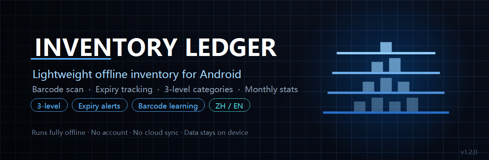
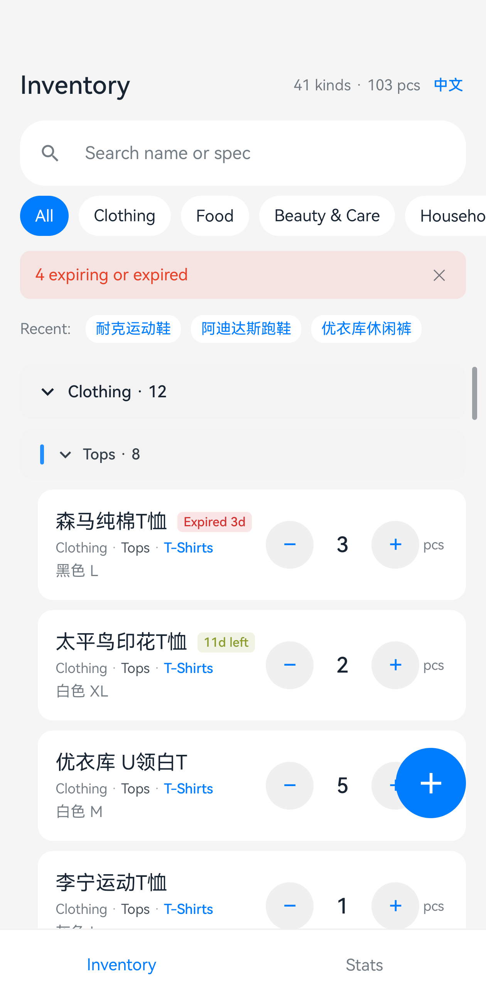
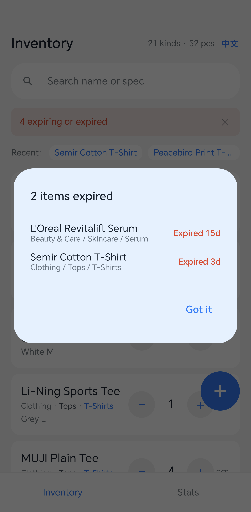
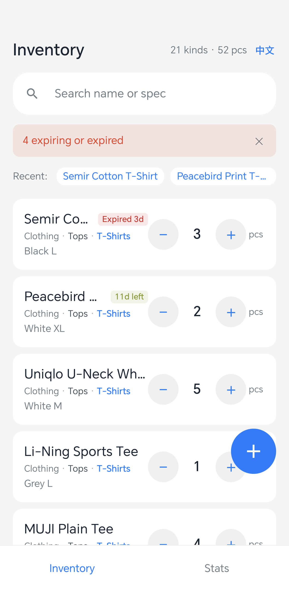
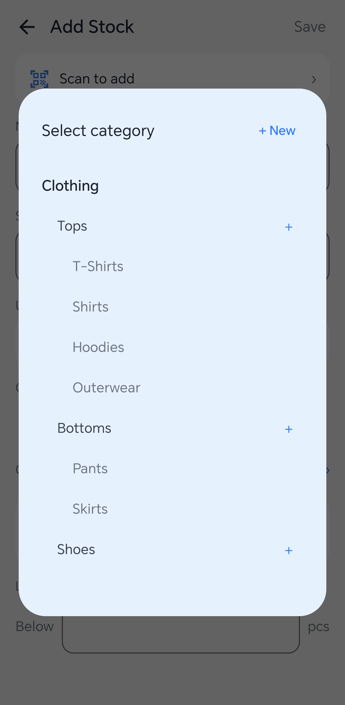
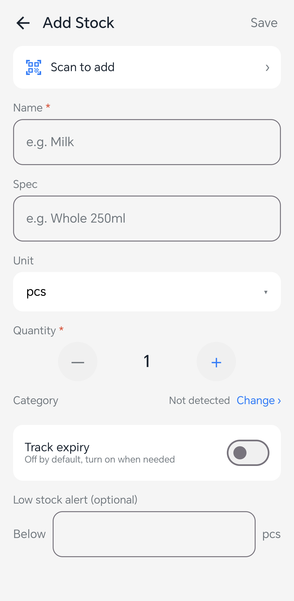
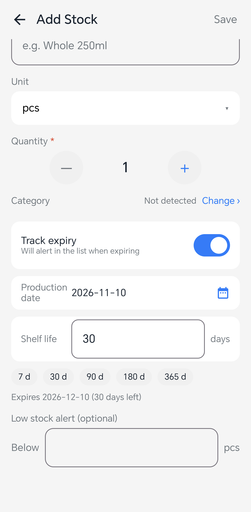
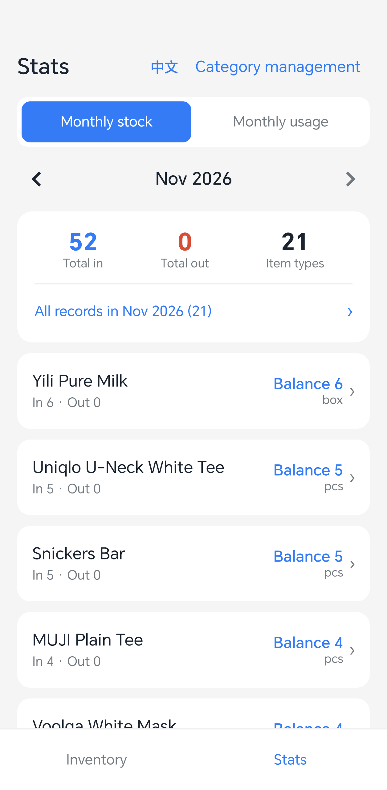
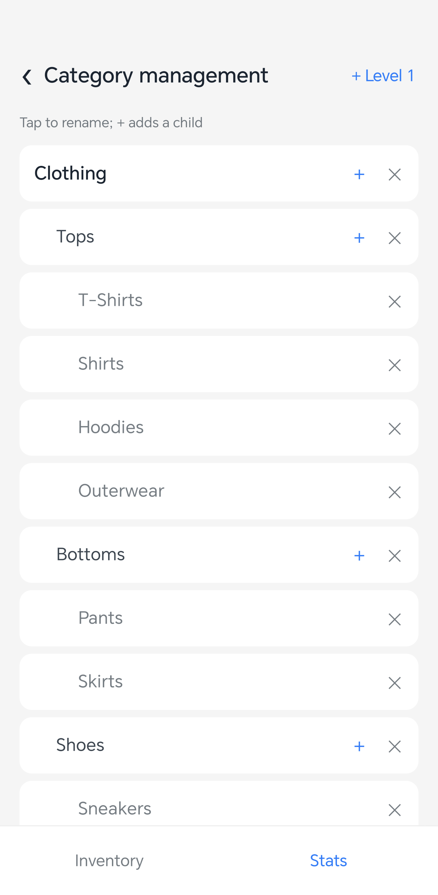
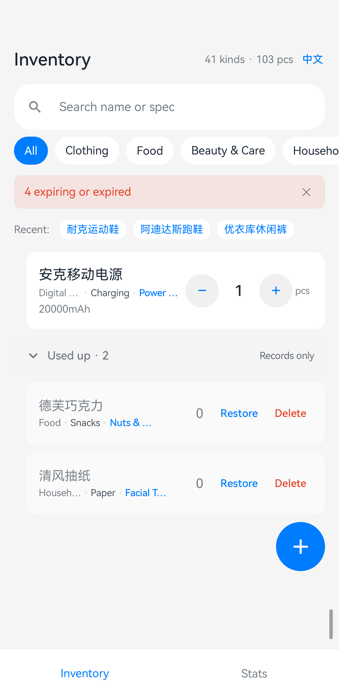

# Inventory Ledger

**Lightweight offline inventory for Android — barcode scan · expiry tracking · 3-level categories**

[](https://opensource.org/licenses/MIT)
[](https://kotlinlang.org/)
[](https://developer.android.com/jetpack/compose)
[](https://developer.android.com/training/data-storage/room)
[](https://developer.android.com/about/versions/nougat)
[](https://github.com/Levanll/InventoryLedger/releases/latest)
[](#)

[中文](README.md) ｜ **English** ｜ **[Official site](https://levanll.github.io/InventoryLedger/en/)** ｜ [Releases](https://github.com/Levanll/InventoryLedger/releases)



---

## The 10-second version

A personal inventory app for Android: add items by scanning a barcode or typing, adjust quantities right in the list, and **expiring items are tracked and sorted by urgency** — with an expired-item summary every time you open the app.

Three things set it apart from other inventory apps: **it understands three category levels** (Beauty & Care → Skincare → Serum, with same-category items always grouped together and never split by expiry), **it runs entirely offline** (local Room database, no account, no cloud sync — the network is used only for barcode lookup and update checks, both optional and both safe to fail), and **its data is auditable** (records are append-only, undo writes a compensating entry, and monthly movements trace back to the individual transaction).

---

## Why it exists

A notes app can't do categories. A professional WMS is far too heavy.

| Scenario | Notes app | Professional inventory software | This project |
|---|---|---|---|
| "How much milk is left?" | Type a line, rewrite to change | Create SKU, add supplier first | Tap `−/+` in the list |
| Categories down to "Serum" | Not possible | Configure a category tree | 53 level-3 categories built in, fully editable |
| Which bottle expires soon? | Track it yourself | Enable batch management | Enter shelf life once, remaining days always shown |
| Scan to enter | Not possible | Usually needs a paid account | Free, and no Google services required |
| Where is my data | Cloud (someone else's server) | Cloud | Local Room database on device |

---

## Features

| | Feature | What it actually does | Why it matters |
|---|---|---|---|
| 🗂 | **Three category levels** | Level 1 → 2 → 3 (Clothing → Tops → T-Shirts). Categories can be created, renamed, deleted; built-in and user-made behave identically | Two levels run out fast once inventory grows; and without correct tree ordering, items of the same category scatter across the list |
| ⏳ | **Expiry with in-group sorting** | Off by default, enable when needed; enter production date + shelf life and the expiry date is computed. **Same-category items stay together**; within a group, items with expiry sort by remaining days, expired (negative) first | Global expiry-first sorting mixes "T-shirt" with "Milk" — it makes finding things slower, not faster |
| 🔔 | **Expired summary on launch** | Opening the app shows every expired item with its category path and days overdue | Expired things never speak up on their own |
| 📷 | **Barcode scan + product lookup** | Pure-Java ZXing decoding (no GMS / ML Kit). Lookup results appear as a **suggestion card** — nothing is written until you tap "Use" | Third-party product data can be wrong or stale; writing it straight into the form turns someone else's error into your inventory fact |
| 🧠 | **Barcode self-learning** | Once you type or accept a product, the app remembers barcode → name/brand/spec/category; the next scan fills everything in | Public barcode databases are thin outside the US/EU, but anything you entered once you never enter again |
| ↔️ | **Inline quantity stepper** | Tap `− 1 ＋` directly on each row — no detail screen. Reaching zero prompts to delete | The most frequent actions are "used one" and "bought a few"; every extra screen transition is friction |
| 🗃 | **Used-up section** | Items kept at zero collect in a collapsed section at the bottom of the list, where they can be restored or deleted | Used-up things should neither vanish without a trace nor occupy the main list — there needs to be a middle place |
| ↩️ | **Everything is undoable** | Records are append-only; undo writes a reversing entry and never mutates history. One-tap undo | You need to be able to take a mistake back — and to see what changed, when |
| 📊 | **Monthly stock & usage** | Aggregated per calendar month, switch months, drill into per-item transactions; usage view includes month-over-month change | "How much did I actually use this month" is the only basis for restocking decisions |
| 🌐 | **Chinese / English, switchable** | Both the Inventory and Stats headers carry an `EN` / `中文` toggle. Takes effect immediately, no restart, and the choice is remembered | Labels, category names, units and date formats all follow — not just the page title |
| 📴 | **No account, no cloud** | Everything is in a local Room database. Network is used only for barcode lookup; failure affects nothing | Household and small-shop inventory has no reason to live on someone else's server |

---

## Quick start

### 1. Download

Get `InventoryLedger-1.4.0.apk` from [Releases](https://github.com/Levanll/InventoryLedger/releases/latest).

> Android will warn about installing from an unknown source. Allow it for your file manager or browser — this is the normal side-loading flow.

### 2. First launch

The database is created with 80 categories (7 level-1, 20 level-2, 53 level-3) and 83 name-recognition rules. No configuration needed.

### 3. Add something

Tap the `＋` button → type a name → set quantity → save. The category is matched automatically (e.g. "Milk" → Food / Fresh / Dairy); tap "Change" if it's wrong.

Turn on **Track expiry** to enter a production date and shelf life.

### 4. Day to day

Adjust quantities with `−/+` on each row. Reaching zero asks whether to delete the item.

### Requirements

| Item | Requirement |
|---|---|
| OS | Android 7.0 (API 24) and above |
| Storage | About 10 MB |
| Permissions | Camera (requested only when scanning, can be denied); Network (barcode lookup and update checks); Install apps (in-app updates only) |
| Network | Optional. Everything except barcode lookup and update checks works offline; update checks can be turned off |

---

## Screenshots

> All screenshots are light mode with the system status bar cropped, in both languages.

| Inventory list · grouped by category | Expired on launch |
|---|---|
|  |  |
| *Five T-shirts grouped; "Expired 3d" sorts first within the group* | *With category path and days overdue* |

| Category grouping · category beats expiry | Category picker · indentation shows depth |
|---|---|
|  |  |
| *T-Shirts → Shirts → Dairy, sorted by days left within each group* | *Level 1 flush, level 2 indented 16dp, level 3 by 32dp* |

| Add stock · scan entry and fields | Expiry · computed live |
|---|---|
|  |  |
| *Category auto-detected from the name, editable* | *7/30/90/180/365 day presets* |

| Monthly stats · stock and usage | Category management · full CRUD |
|---|---|
|  |  |
| *Switch months, tap a row for details* | *＋ adds a child, ✕ deletes, three levels max* |

| Used up · zeroed items still have a home |
|---|
|  |
| *Items kept at zero collect here and can be restored or deleted at any time* |

---

## Capabilities

**80 preset categories · 83 recognition rules · 6 tables · 2 record types**

- **Three-level category tree**: a recursive CTE builds a path string (`00010Clothing/00011Tops/00111T-Shirts`) whose lexical order equals pre-order DFS — avoiding the layer scrambling that `ORDER BY sort` produces
- **Dynamic category chips**: rendered from SQL stats for `quantity > 0` at `depth = 1` only; nothing is hard-coded in the UI
- **Inline quantity adjustment**: writes a `reason='MANUAL'` record, sharing the same accounting as everything else
- **Zeroing never deletes**: at quantity 0 the item leaves the main list but the row is kept; choosing "Keep record" files it under the **Used up** section, where it can be restored or deleted, and history and monthly stats always resolve
- **Expiry computed, not stored**: expiry is derived from `production_date + shelf_life_days` so editing the shelf life can never desynchronise a stored expiry timestamp
- **Three-tier barcode source**: local self-learned cache → existing items → network (Open Food Facts / go-upc), local first
- **Monthly aggregation**: half-open interval `[month start, next month start)`; undone records count (undoing a withdrawal cancels the usage)
- **i18n without Activity recreation**: a Compose `mutableStateOf` language holder, persisted in SharedPreferences. Switching re-composes in place, so no screen state is lost

---

## Architecture

```text
┌──────────────────────────────────────────┐
│ MainActivity                             │
│ I18n.init → enableEdgeToEdge → Theme → VM│
└───────────────────┬──────────────────────┘
                    │
        ┌───────────▼────────────┐
        │ MainScreen (2 tabs)    │
        │ Inventory / Stats      │
        └───┬────────────────┬───┘
            │                │
    ┌───────▼──────┐  ┌──────▼───────┐
    │ InventoryScreen│ │ StatsScreen  │
    │ InboundScreen  │ │ CategoryManage│
    │ ScanScreen     │ │ DetailScreen │
    └───────┬──────┘  └──────┬───────┘
            │   StateFlow     │
    ┌───────▼─────────────────▼───────┐
    │ MainViewModel                    │
    │ Single state holder              │
    └───────┬──────────────────────────┘
            │
    ┌───────▼──────────────────────────────────┐
    │ Domain layer                              │
    │ InventoryService  inbound / adjust / undo │
    │ ClassifyService   n-gram matching         │
    │ CategoryService   tree CRUD + migration   │
    │ StatsService      monthly aggregation     │
    │ BarcodeLookup    3-tier lookup            │
    └───────┬──────────────────────────────────┘
            │
    ┌───────▼──────────────────────────────────┐
    │ Room (SQLite): item / stock_record /      │
    │ category / category_rule / barcode_memo / │
    │ form_memo                                 │
    └──────────────────────────────────────────┘
```

Two hard boundaries:

- **Every write goes through `withTransaction()`** — inbound, adjust, undo, category changes. Any failure rolls the whole thing back
- **Undo writes a compensating record** — `stock_record` is append-only. Undo inserts the reverse entry and points the original's `reverted_by` at it. History values are never mutated, which is what makes the audit trail real

---

## Project layout

```text
InventoryLedger/
├── app/src/main/java/cn/levanll/inventory/
│   ├── data/
│   │   ├── entity/          6 tables
│   │   ├── dao/             ItemDao / CategoryDao / RecordDao / BarcodeDao
│   │   └── db/              AppDatabase (4 migrations) + seed data
│   ├── domain/
│   │   ├── Models.kt        entities, error codes, YearMonth, ExpiryStatus
│   │   ├── InventoryService inbound branches / adjust / undo
│   │   ├── ClassifyService  n-gram matching + weight learning
│   │   ├── CategoryService  tree CRUD + item migration
│   │   ├── StatsService     monthly aggregation
│   │   └── BarcodeLookup    3-tier lookup + self-learning
│   ├── i18n/
│   │   ├── I18n.kt          language state, persisted
│   │   ├── CategoryNames.kt zh/en category map
│   │   └── UnitNames.kt     zh/en unit map
│   └── ui/
│       ├── MainViewModel    single source of truth (StateFlow)
│       ├── InventoryScreen  list + expiry badge + expired dialog
│       ├── InboundScreen    scan / expiry / picker / barcode conflict
│       ├── StatsScreen      monthly stats + details
│       ├── CategoryManage   tree maintenance
│       ├── ScanScreen       CameraX + ZXing
│       └── theme/Widgets
├── docs/images/             screenshots (zh/ and en/)
├── scripts/                 icon generator, screenshot helper
├── keystore/                signing (git-ignored)
└── app/proguard-rules.pro   R8 rules
```

Notable spots:

| Path | Why it matters |
|---|---|
| `AppDatabase.kt` | Four-version migration chain plus an idempotent seed guarded by `seed_version` |
| `CategoryDao.listForPick()` | Recursive CTE path string — this is what keeps three-level categories correctly grouped |
| `ItemDao.search()` | Three sort keys: category tree → has-expiry first → remaining days |
| `BarcodeLookupService` | Negative cache uses a `NotFound` sentinel (`ConcurrentHashMap` rejects null values) |
| `ScanScreen.decodeBitmap()` | Uses `ImageProxy.toBitmap()` rather than hand-parsing YUV planes |
| `I18n.kt` | Language as Compose state, persisted — no Activity recreation |

---

## Tech stack

| Area | Choice | Reason |
|---|---|---|
| Language | Kotlin 1.9.24 | Coroutines for transactions and IO |
| UI | Jetpack Compose (BOM 2024.06) | Declarative; state and form stay in sync cheaply |
| Database | Room 2.6.1 (SQLite) | Compile-time SQL validation, recursive CTE, migrations |
| Scanning | ZXing 3.5.3 + CameraX 1.3.4 | **No GMS / ML Kit** — works on HarmonyOS and other devices without Google services |
| Build | AGP 8.5.2 + Gradle 8.9 + KSP | KSP instead of KAPT |
| Minification | R8 (`isMinifyEnabled = true`) | 17.67 MB → **2.61 MB** |
| Signing | v1 + v2 + v3, RSA 2048 | Android 7.0 through 14 |

**No third-party runtime dependencies** beyond AndroidX and ZXing.

---

## Known limitations

| Limitation | Cause | Impact |
|---|---|---|
| Barcode coverage is limited for non-US/EU goods | Open Food Facts skews to Western groceries; go-upc is reverse-engineered HTML that breaks when the site changes | Type it in when lookup fails — **the local self-learning cache remembers it after the first time** |
| No commercial barcode database | Those services require paid API keys | Roughly 60–70% coverage, not 100% |
| Single location only | Designed for personal / household / small-shop use | Split into separate items if you keep stock in multiple places |
| No system notifications | Needs notification permission; the interruption isn't worth it for personal use | Expiry reminders appear when you open the app |
| No cloud sync, no export | Privacy first, plus avoiding backend cost | Switching phones means re-entering data |

---

## Roadmap

### Planned

- [ ] **Better barcode coverage** — add a commercial source as an optional provider (bring your own key)
- [ ] **Home-screen widget** — show the count of expiring items

### Considering

- [ ] Batch edit (multi-select and re-categorise)
- [ ] Image attachments (the `image_uri` column already exists)
- [ ] Manual light/dark override (currently follows the system)

### Explicitly out of scope

- ❌ Accounts, cloud sync, multi-device
- ❌ Supply chain, purchase orders, bookkeeping
- ❌ Ads, analytics, crash reporting
- ❌ Batch/lot tracking (it would double the data-entry cost)

---

## Privacy

| Question | Answer |
|---|---|
| Does it upload my data? | **No.** No account, no sync, no analytics. Everything is in a local Room database. If update checks are enabled, the app requests the latest version number from GitHub once per launch; that request carries no inventory or personal data |
| Does it use the network? | For barcode lookup against `openfoodfacts.org` and `go-upc.com`, sending **the barcode alone**; and for optional update checks against the `api.github.com` version endpoint |
| Can I use it fully offline? | Yes. Everything except barcode lookup and update checks works without a network |
| What permissions? | Camera (scanning), network (lookup and update checks), and install apps (in-app updates only). **No storage, contacts, location or notification permissions** |
| Where is the data? | `/data/data/cn.levanll.inventory/databases/inventory.db` |
| How do I delete everything? | Uninstall the app; Android removes the private directory |

---

## Contributing

Issues and pull requests are welcome. Three ground rules:

1. **No new third-party runtime dependencies** (AndroidX + ZXing is enough)
2. **Every write must go through `withTransaction()`** — no bare database writes
3. **Undo must use a compensating record** — never mutate or delete historical rows

### Reporting bugs

Please check [existing issues](https://github.com/Levanll/InventoryLedger/issues) first. Include:

- Device model and Android version
- Steps to reproduce
- `adb logcat -d -b crash` output if it crashed

---

## Credits

- [ZXing](https://github.com/zxing/zxing) — pure-Java barcode decoding, no Google services required
- [CameraX](https://developer.android.com/jetpack/androidx/releases/camera) — camera preview and frame analysis
- [Room](https://developer.android.com/training/data-storage/room) — compile-checked SQLite
- [Open Food Facts](https://world.openfoodfacts.org/) — open product database
- Everyone who reported a problem

---

## License

Released under the **[MIT License](LICENSE)**, Copyright (c) 2026 Levanll.

Free to use, modify, distribute and sell, including in closed-source form. Keep the copyright notice and licence text.

> **About installing.** The MIT licence provides this software "as is", without warranty. The APK is signed by an individual developer and is not published on any app store. Verify the source before installing.

---

**[⬆ Back to top](#inventory-ledger)**
